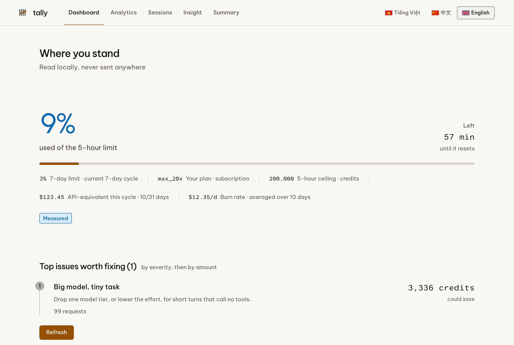
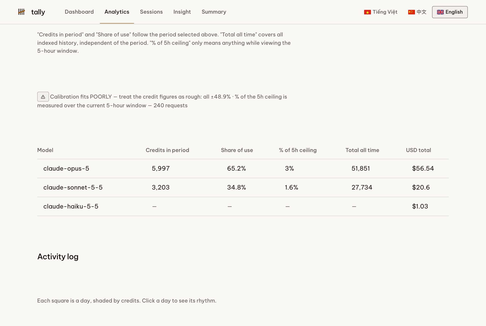
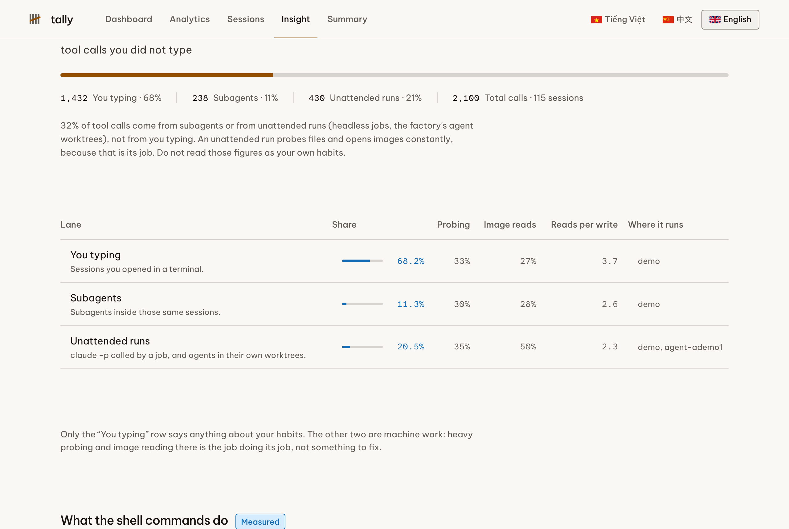

# tally — a local Claude Code usage dashboard for plan limits, credits and cost

**tally** reads the transcripts Claude Code already writes on your machine and tells you where your
plan went: how much of your **5-hour limit** each model ate, what the same work would have cost on
the **Anthropic API**, which sessions are burning the ceiling, and **who is actually driving the
tool calls** — you, your subagents, or your unattended jobs.

Everything runs locally. Nothing is uploaded. It never reads the text of your conversations.

[](https://github.com/nguyenthienthanh/tally/actions/workflows/ci.yml)
[](./LICENSE)
[](https://nodejs.org)

> Keywords, so search finds this: Claude Code usage dashboard · Claude plan limit tracker · Claude
> Code credits and token usage · Claude Max 20x 5-hour window · Claude Code cost analytics ·
> subagent cost · `ccusage` alternative · local-first, no telemetry.

---

## Screenshots

All three use synthetic demo data from `scripts/make-fixture.mjs`, not a real account.

| Dashboard: where you stand now | Analytics: plan share per model |
| --- | --- |
|  |  |



---

## The three questions it answers

### 1. How much of my *plan* is each model eating?

Not dollars. The actual plan credits, computed with the credit constants Claude Code itself stores
in `~/.claude.json`, against the 5-hour ceiling for your tier. A model with no published credit
rate renders `—`, never `0`, because not knowing is not the same as zero.

### 2. What are my subagents and my background jobs costing me?

Transcripts mark subagent turns (`isSidechain`) and headless runs (`entrypoint: sdk-cli`), and
agents running in their own git worktrees look exactly like you typing until you check the working
directory. tally separates all three and labels them, so you never read a robot's habits as your
own. See [the three lanes](./docs/behaviour.md).

### 3. Where is the waste?

Five findings, each with the money attached rather than advice attached: 1-hour prompt cache writes
(2× the write price, needs three reads to break even), cache misses, subagent-heavy sessions, an
expensive model answering short questions with no tool calls, and 5-hour ceiling risk.

---

## Quick start

Requires **Node 22.5 or newer**. It uses the built-in `node:sqlite`, so there are no native modules
to compile and no database to install.

```bash
git clone https://github.com/nguyenthienthanh/tally.git
cd tally
pnpm install && pnpm build

node dist/cli.js doctor     # check every data source
node dist/cli.js index      # first scan
node dist/cli.js serve      # http://127.0.0.1:7777
```

On the machine this was built on, the first scan reads **4.5 GB across 3,473 transcript files in
about 13 seconds** and produces a 55 MB SQLite index. Later runs read only the bytes appended since
last time.

Full walkthrough: [docs/getting-started.md](./docs/getting-started.md).

## Commands

| Command | What it does | Useful flags |
| --- | --- | --- |
| `tally index` | Scan `~/.claude/projects/**/*.jsonl` into SQLite | `--full` |
| `tally report` | Print tables in the terminal | `--grain=hour\|day\|month\|year`, `--tz=…` |
| `tally serve` | Open the dashboard | `--port=7777`, `--watch`, `--redact` |
| `tally doctor` | Check every data source and say which are missing | |

Full reference: [docs/cli.md](./docs/cli.md).

## The five pages

- **Dashboard** — where you stand right now: 5-hour and 7-day limits, your plan tier, burn rate, and
  the issues worth fixing first, ranked by severity then by amount.
- **Analytics** — plan share and dollar equivalent per model, hour / day / month / year breakdowns,
  an hour-of-day × day-of-week heatmap, the rolling 5-hour window, and cost by project.
- **Sessions** — every session, or only the ones still running, or one you pick.
- **Insight** — how you actually work: the three lanes, what your shell commands are for, what you
  depend on outside the model, and where sessions get stuck. Every figure is labelled **measured**
  or **Claude inferred**, with its sample size.
- **Summary** — the full table behind the insight page.

The insight page reads Claude Code's existing `/insights` output for free. Asking Claude to explain
your own numbers runs `claude -p` and spends your own quota, so it asks first, in your chosen
language and depth, and shows a cost estimate **measured from your own past headless runs** rather
than guessed.

## Why the credit numbers are an estimate, and how it says so

Anthropic does not publish how plan credits are computed. tally fits a formula against the live
`five_hour_pct` your own client reports and **shows you how far off the fit is**. On the machine
this was built on, the fitted hypothesis (`input + output + cache writes + 0.025 × cache reads`)
lands within 3 to 9% of the live figure.

It refuses to pretend in three specific ways:

- **`low_signal`** — under 5% of the ceiling used, too little to fit against.
- **`stale_index`** — the index is older than the limit snapshot, so the comparison would
  systematically undercount. It tells you to run `tally index`.
- **extrapolated** — a window far heavier than the one the fit was made on is labelled an estimate
  instead of being presented as fact.

USD figures are not an estimate: they match the `total_cost_usd` Claude Code reports to 1e-9 on the
data tested. Details: [docs/credits.md](./docs/credits.md).

## Privacy

tally reads files that are already on your disk and sends nothing anywhere.

- **No conversation text.** The parser counts `tool_use` blocks, derives a few facts from them, then
  discards `message.content`. The database schema has no column that could hold message text.
- **From tool calls it keeps only derived values**: the tool name, the shell verb (`grep`, `pnpm`),
  the file extension, and the last three path segments. Never a raw command string, never file
  contents.
- **No outbound network, ever.** A unit test scans every source file for outbound-capable calls, and
  an end-to-end test fails if the page requests any host other than `127.0.0.1`.
- **One guarded write path.** Running `/insights` or asking Claude to explain your numbers are the
  only actions that write anything, both POST-only and guarded by a token minted per server start.
- `--redact` replaces project paths with salted hashes before anything reaches the page.

Full statement: [PRIVACY.md](./PRIVACY.md).

## How it compares to ccusage

[`ccusage`](https://github.com/ryoppippi/ccusage) is excellent and covers far more tools than this
one: Claude Code, Codex, Gemini CLI, Antigravity, OpenClaw and others. If you want broad coverage
across agents, use it.

| | tally | ccusage |
| --- | --- | --- |
| Tools covered | Claude Code only | many agent CLIs |
| Cost in USD | yes | yes |
| Share of your **plan** in credits | yes, fitted and error-labelled | not a concept |
| 5-hour ceiling and 7-day limit | yes | partial |
| You vs subagents vs unattended jobs | yes | no |
| Priced waste findings | yes | no |
| Browser dashboard | yes, local | terminal, plus a blocks view |

They answer different questions. Running both is reasonable.

## FAQ

### Does tally send my usage anywhere?

No. There is no telemetry, no analytics, no update check and no remote host. The absence is enforced
by tests, not by a promise in a README.

### Does it read my conversations?

No. It reads per-request metadata (model, token counts, timestamps, tool names) and discards message
content before anything is stored.

### Which plans does it work with?

Any Claude Code setup. The plan tier is detected from `~/.claude.json`. Credit figures need a tier
with a published ceiling (for example Max 5x or Max 20x). On a pay-as-you-go API key there are no
plan credits, so the dashboard shows the USD side and hides the credit side rather than inventing a
ceiling.

### Why is my credit number slightly different from the one in Claude Code?

Because the formula is fitted, not published. tally shows the fit error next to the number so you can
see how much to trust it.

### Does it need my API key?

No. It never calls an API. The one optional action that uses the model runs your local `claude`
binary and your own quota, after you agree.

### What if I have no `~/.claude` data yet?

`tally doctor` will say which of the five data sources are missing. The dashboard renders what
exists and marks the rest unknown rather than showing zeros.

## Documentation

- [Getting started](./docs/getting-started.md) — install, first index, serving, flags
- [CLI reference](./docs/cli.md) — every command, every flag, exit codes
- [Credits and cost](./docs/credits.md) — the formula, the calibration, what makes it refuse
- [Behaviour and the three lanes](./docs/behaviour.md) — what the insight page measures, and what it
  deliberately does not flag
- [Architecture](./docs/architecture.md) — ingest, index, engine, server, and where privacy is
  enforced
- [Privacy](./PRIVACY.md) · [Contributing](./CONTRIBUTING.md) · [Changelog](./CHANGELOG.md)

## Contributing

Bug reports and pull requests are welcome. The house rules in
[CONTRIBUTING.md](./CONTRIBUTING.md) are short and they are enforced by tests rather than by review:
not knowing is not zero, constants come from the caller, an extrapolation says so, no outbound
network, no conversation content.

## License

MIT. See [LICENSE](./LICENSE).
