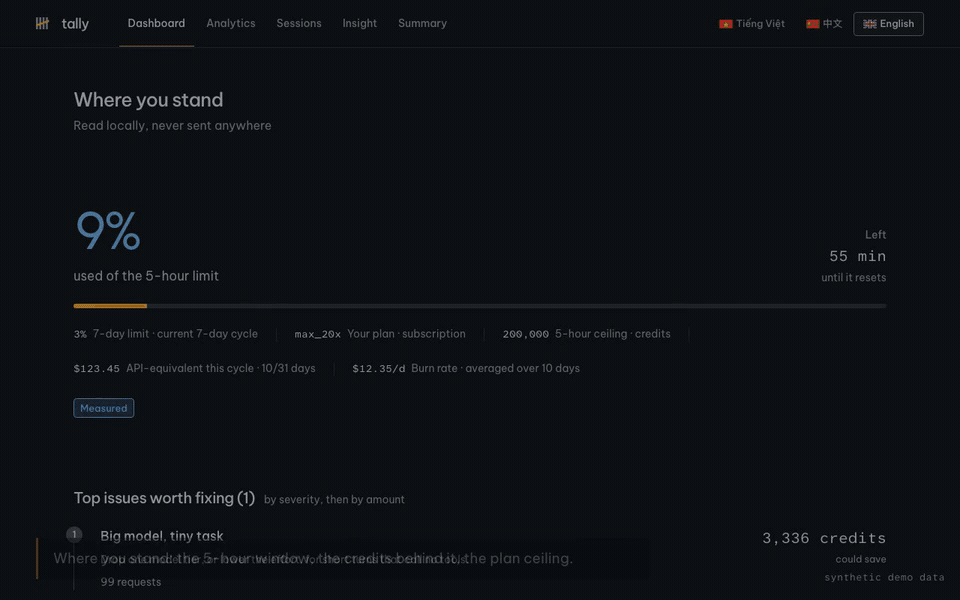
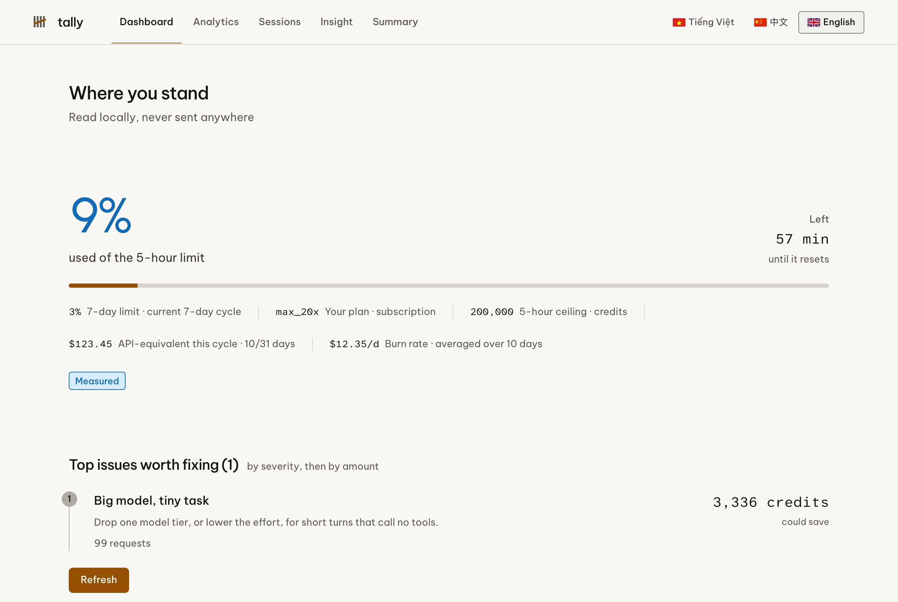
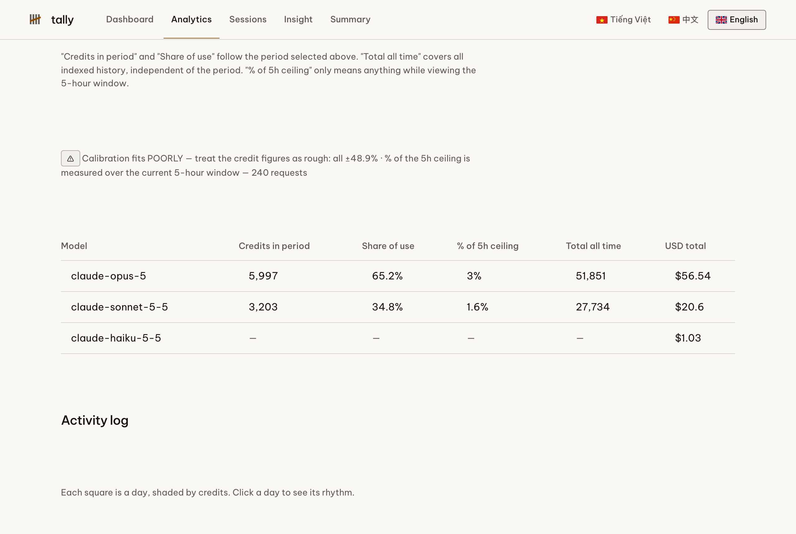
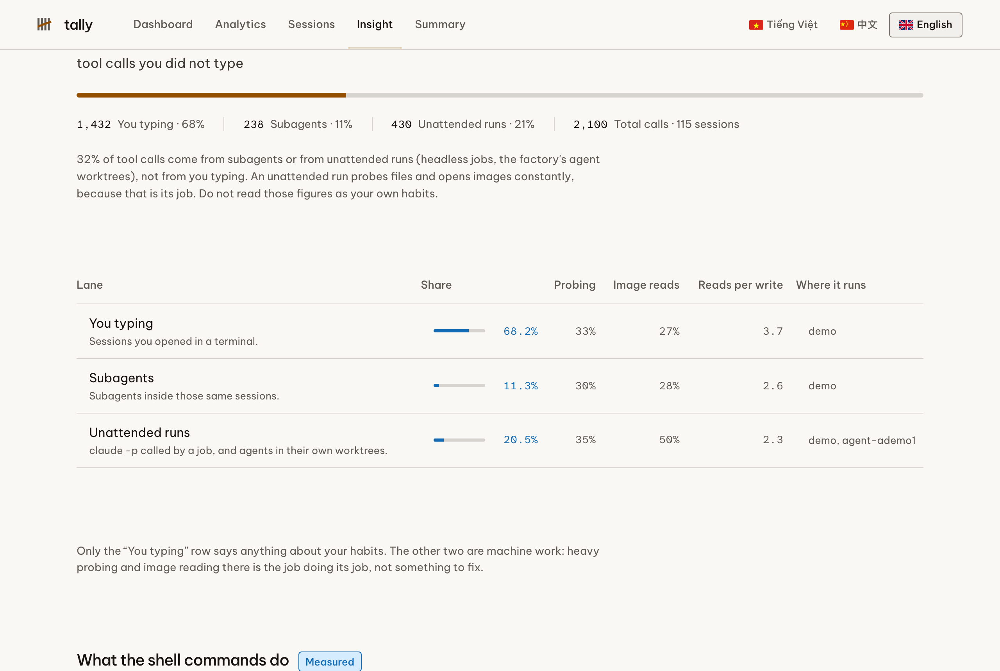

# tally: bảng điều khiển cục bộ cho hạn mức, credit và chi phí Claude Code

[English](./README.md) · **Tiếng Việt** · [中文](./README.zh.md)

**tally** đọc chính những transcript mà Claude Code đã ghi sẵn trên máy bạn, rồi nói cho bạn biết
gói của bạn đi đâu: mỗi model ăn bao nhiêu phần **hạn mức 5 giờ**, cùng khối việc đó nếu chạy qua
**Anthropic API** thì tốn bao nhiêu tiền, phiên nào đang đốt trần, và **ai mới thật sự gọi tool**:
bạn, subagent của bạn, hay những job chạy không người trông.

Mọi thứ chạy cục bộ. Không upload gì. Không bao giờ đọc nội dung hội thoại của bạn.

[](https://github.com/nguyenthienthanh/tally/actions/workflows/ci.yml)
[](./LICENSE)
[](https://nodejs.org)

> Từ khoá để tìm ra trang này: dashboard usage Claude Code · theo dõi hạn mức gói Claude · credit và
> token Claude Code · cửa sổ 5 giờ của Claude Max 20x · phân tích chi phí Claude Code · chi phí
> subagent · thay thế `ccusage` · chạy cục bộ, không telemetry.

---

## Xem nó chạy



Bản 55 giây có lời đọc: [docs/media/demo.mp4](./docs/media/demo.mp4). Số liệu trong video là dữ liệu
tổng hợp để demo, và video ghi rõ điều đó trên màn hình.

## Ảnh màn hình

Cả ba ảnh dùng dữ liệu tổng hợp từ `scripts/make-fixture.mjs`, không phải tài khoản thật.

| Tổng quan: bạn đang ở đâu | Phân tích: phần gói của từng model |
| --- | --- |
|  |  |



---

## Ba câu hỏi nó trả lời

### 1. Mỗi model ăn bao nhiêu phần *gói* của tôi?

Không phải đô la, mà là credit thật của gói, tính bằng chính các hằng số credit mà Claude Code lưu
trong `~/.claude.json`, đối chiếu với trần 5 giờ của hạng gói bạn đang dùng. Model nào không có mức
credit công bố thì hiện `n/a`, không bao giờ hiện `0`, vì không biết khác với bằng không.

### 2. Subagent và job nền đang tốn của tôi bao nhiêu?

Transcript có đánh dấu lượt của subagent (`isSidechain`) và lượt chạy headless (`entrypoint:
sdk-cli`), còn agent chạy trong git worktree riêng thì trông y hệt bạn đang gõ cho tới khi soi thư
mục làm việc. tally tách cả ba và dán nhãn rõ, để bạn không đọc thói quen của máy thành thói quen
của mình. Xem [ba làn](./docs/vi/behaviour.md).

### 3. Lãng phí nằm ở đâu?

Năm phát hiện, mỗi cái đi kèm số tiền chứ không đi kèm lời khuyên suông: ghi cache 1 giờ (giá gấp
2 lần ghi thường, cần ba lần đọc mới hoà), cache trượt, phiên nặng subagent, model đắt trả lời câu
ngắn mà không gọi tool nào, và rủi ro chạm trần 5 giờ.

---

## Bắt đầu nhanh

Cần **Node 22.13 trở lên**. Nó dùng `node:sqlite` dựng sẵn trong Node, và 22.13 là bản đầu tiên mở
module đó mà không cần cờ thử nghiệm, nên không phải biên dịch native module nào, cũng không phải
cài database nào.

```bash
git clone https://github.com/nguyenthienthanh/tally.git
cd tally
pnpm install && pnpm build

node dist/cli.js doctor     # kiểm mọi nguồn dữ liệu
node dist/cli.js index      # lần quét đầu
node dist/cli.js serve      # http://127.0.0.1:7777
```

Trên máy đã dựng ra nó, lần quét đầu đọc **4,5 GB qua 3.473 file transcript trong khoảng 13 giây**
và sinh ra một index SQLite 55 MB. Các lần sau chỉ đọc phần byte mới ghi thêm.

Hướng dẫn đầy đủ: [docs/vi/getting-started.md](./docs/vi/getting-started.md).

## Lệnh

| Lệnh | Làm gì | Cờ hay dùng |
| --- | --- | --- |
| `tally index` | Quét `~/.claude/projects/**/*.jsonl` vào SQLite | `--full` |
| `tally report` | In bảng ngay trong terminal | `--grain=hour\|day\|month\|year`, `--tz=…` |
| `tally serve` | Mở dashboard | `--port=7777`, `--watch`, `--redact` |
| `tally doctor` | Kiểm mọi nguồn dữ liệu và nói rõ cái nào thiếu | |

Tham chiếu đầy đủ: [docs/vi/cli.md](./docs/vi/cli.md).

## Năm trang

- **Tổng quan**: bạn đang ở đâu ngay lúc này: hạn mức 5 giờ và 7 ngày, hạng gói, tốc độ đốt, và các
  vấn đề đáng sửa trước, xếp theo mức nghiêm trọng rồi tới số tiền.
- **Phân tích**: phần gói và số đô tương đương của từng model, chia theo giờ / ngày / tháng / năm,
  bản đồ nhiệt giờ trong ngày × thứ trong tuần, cửa sổ 5 giờ đang trôi, và chi phí theo dự án.
- **Phiên**: mọi phiên, hoặc chỉ những phiên còn đang chạy, hoặc một phiên bạn chọn.
- **Thói quen**: bạn làm việc kiểu gì: ba làn, các lệnh shell dùng để làm gì, bạn dựa vào gì ở bên
  ngoài model, và phiên hay vướng ở đâu. Mỗi con số đều có nhãn **đo được** hoặc **Claude suy luận**,
  kèm cỡ mẫu.
- **Tóm tắt**: bảng đầy đủ nằm sau trang thói quen.

Trang thói quen đọc sẵn kết quả `/insights` mà Claude Code đã tạo, không tốn gì. Còn nhờ Claude giải
thích chính số của bạn thì chạy `claude -p` và tiêu hạn mức của bạn, nên nó hỏi trước, cho bạn chọn
ngôn ngữ và độ sâu, và hiện mức giá **đo từ chính các lượt headless bạn đã chạy** chứ không đoán.

## Vì sao con số credit là ước lượng, và nó nói điều đó thế nào

Anthropic không công bố cách tính credit của gói. tally khớp một công thức với chính `five_hour_pct`
mà client của bạn báo về, rồi **cho bạn thấy khớp lệch bao nhiêu**. Trên máy đã dựng ra nó, giả
thuyết được chọn (`input + output + ghi cache + 0,025 × đọc cache`) lệch 3 đến 9% so với số báo về.

Nó từ chối giả vờ trong ba trường hợp cụ thể:

- **`low_signal`**: dùng chưa tới 5% trần, quá ít để khớp.
- **`stale_index`**: index cũ hơn mốc chụp hạn mức, nên so sánh sẽ đếm thiếu một cách có hệ thống.
  Nó bảo bạn chạy `tally index`.
- **ngoại suy**: một cửa sổ nặng hơn hẳn cửa sổ dùng để khớp thì bị dán nhãn ước lượng, không được
  trình bày như sự thật.

Số USD thì không phải ước lượng: nó khớp `total_cost_usd` mà Claude Code báo tới mức 1e-9 trên dữ
liệu đã thử. Chi tiết: [docs/vi/credits.md](./docs/vi/credits.md).

## Riêng tư

tally đọc những file vốn đã nằm trên đĩa của bạn và không gửi gì đi đâu.

- **Không đọc nội dung hội thoại.** Bộ phân tích đếm các khối `tool_use`, rút vài dữ kiện từ đó, rồi
  bỏ `message.content`. Lược đồ database không có cột nào chứa được chữ của tin nhắn.
- **Từ lời gọi tool chỉ giữ giá trị đã rút**: tên tool, động từ shell (`grep`, `pnpm`), đuôi file, và
  ba đoạn cuối của đường dẫn. Không bao giờ giữ chuỗi lệnh thô, không bao giờ giữ nội dung file.
- **Không có đường ra mạng, không bao giờ.** Một unit test quét mọi file nguồn tìm lời gọi có thể đi
  ra ngoài, và một test đầu-cuối sẽ đỏ nếu trang gọi tới bất kỳ host nào khác `127.0.0.1`.
- **Chỉ một đường ghi có canh.** Chạy `/insights` hoặc nhờ Claude giải thích số của bạn là hai hành
  động duy nhất ghi gì đó, cả hai chỉ nhận POST và đều cần token sinh mới mỗi lần khởi động server.
- `--redact` thay đường dẫn dự án bằng hash có muối trước khi bất cứ thứ gì tới trang.

Bản đầy đủ: [PRIVACY.vi.md](./PRIVACY.vi.md).

## So với ccusage

[`ccusage`](https://github.com/ryoppippi/ccusage) rất tốt và phủ nhiều công cụ hơn hẳn cái này:
Claude Code, Codex, Gemini CLI, Antigravity, OpenClaw và nhiều cái khác. Cần phủ rộng nhiều agent
thì dùng nó.

| | tally | ccusage |
| --- | --- | --- |
| Công cụ phủ được | chỉ Claude Code | nhiều agent CLI |
| Chi phí USD | có | có |
| Phần **gói** tính bằng credit | có, khớp số và ghi rõ sai số | không có khái niệm này |
| Trần 5 giờ và hạn mức 7 ngày | có | một phần |
| Bạn gõ, subagent, máy tự chạy | có | không |
| Phát hiện lãng phí kèm giá tiền | có | không |
| Dashboard trình duyệt | có, cục bộ | terminal, kèm một chế độ blocks |

Hai cái trả lời hai câu hỏi khác nhau. Chạy cả hai là hợp lý.

## Câu hỏi hay gặp

### tally có gửi dữ liệu dùng của tôi đi đâu không?

Không. Không telemetry, không analytics, không kiểm tra bản mới, không có host từ xa nào. Sự vắng
mặt đó được cưỡng chế bằng test, không phải bằng một lời hứa trong README.

### Nó có đọc hội thoại của tôi không?

Không. Nó đọc metadata theo từng request (model, số token, mốc thời gian, tên tool) và bỏ nội dung
tin nhắn trước khi lưu bất cứ thứ gì.

### Nó chạy với gói nào?

Mọi thiết lập Claude Code. Hạng gói được dò từ `~/.claude.json`. Con số credit cần một hạng có trần
được công bố (ví dụ Max 5x hoặc Max 20x). Với API key trả theo lượt dùng thì không có credit gói,
nên dashboard hiện phần USD và ẩn phần credit, thay vì bịa ra một cái trần.

### Vì sao số credit của tôi hơi khác số trong Claude Code?

Vì công thức là khớp ra, không phải công bố. tally hiện sai số của phép khớp ngay cạnh con số, để
bạn biết nên tin tới đâu.

### Nó có cần API key của tôi không?

Không. Nó không bao giờ gọi API. Hành động tuỳ chọn duy nhất có dùng model thì chạy binary `claude`
cục bộ và hạn mức của chính bạn, sau khi bạn đồng ý.

### Nếu máy tôi chưa có dữ liệu `~/.claude` thì sao?

`tally doctor` sẽ nói thiếu nguồn nào trong năm nguồn. Dashboard hiện cái gì có và đánh dấu phần còn
lại là không biết, chứ không hiện số 0.

## Tài liệu

Mọi trang dưới đây đều có bản tiếng Anh, tiếng Việt và tiếng Trung: `docs/en`, `docs/vi`, `docs/zh`.

- [Bắt đầu](./docs/vi/getting-started.md): cài, quét lần đầu, chạy server, các cờ
- [Tham chiếu CLI](./docs/vi/cli.md): mọi lệnh, mọi cờ, mã thoát
- [Credit và chi phí](./docs/vi/credits.md): công thức, cách hiệu chuẩn, khi nào nó từ chối trả lời
- [Hành vi và ba làn](./docs/vi/behaviour.md): trang thói quen đo gì, và cố ý không gắn cờ cái gì
- [Kiến trúc](./docs/vi/architecture.md): nạp, index, engine, server, và chỗ cưỡng chế quyền riêng tư
- [Riêng tư](./PRIVACY.vi.md) · [Đóng góp](./CONTRIBUTING.md) · [Nhật ký thay đổi](./CHANGELOG.md)

## Đóng góp

Hoan nghênh báo lỗi và pull request. Luật nhà trong [CONTRIBUTING.md](./CONTRIBUTING.md) ngắn gọn và
được cưỡng chế bằng test chứ không bằng soi tay: không biết không phải là số không, hằng số do nơi
gọi truyền vào, ngoại suy thì phải nói là ngoại suy, không có đường ra mạng, không giữ nội dung hội
thoại.

## Giấy phép

MIT. Xem [LICENSE](./LICENSE).
