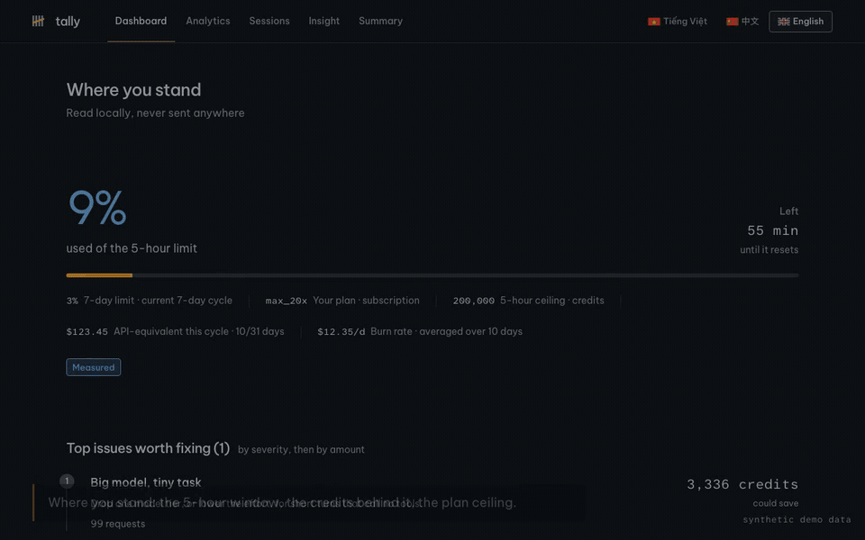
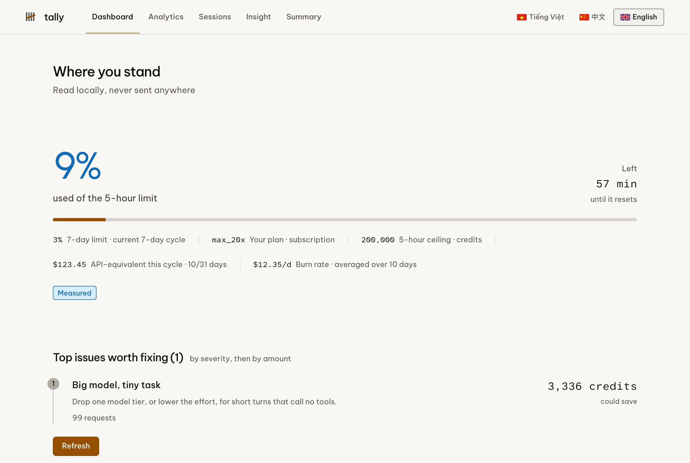
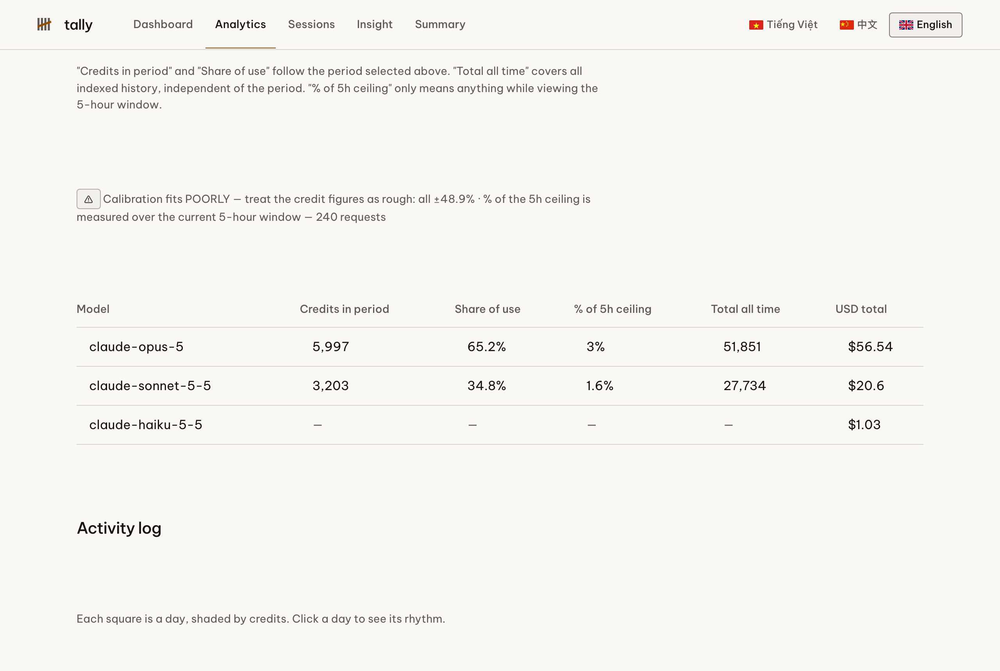
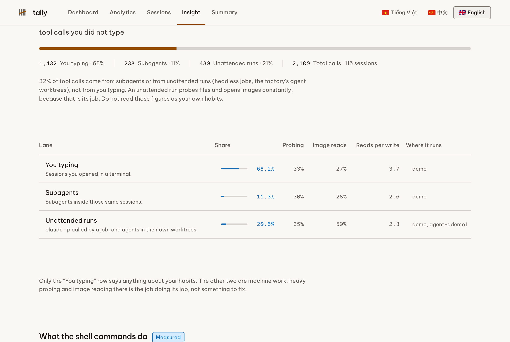

# tally：本地运行的 Claude Code 用量面板，看清套餐额度、credit 与成本

[English](./README.md) · [Tiếng Việt](./README.vi.md) · **中文**

**tally** 读取 Claude Code 已经写在你电脑上的会话记录，告诉你套餐花到哪里去了：每个模型吃掉了多少
**5 小时额度**、同样的工作走 **Anthropic API** 要花多少钱、哪些会话在烧额度，以及**究竟是谁在调用
工具**：你本人、你的 subagent，还是无人值守的任务。

一切都在本地运行，不上传任何东西，也从不读取你的对话内容。

[](https://github.com/nguyenthienthanh/tally/actions/workflows/ci.yml)
[](./LICENSE)
[](https://nodejs.org)

> 便于检索的关键词：Claude Code 用量面板 · Claude 套餐额度追踪 · Claude Code credit 与 token 用量 ·
> Claude Max 20x 的 5 小时窗口 · Claude Code 成本分析 · subagent 成本 · `ccusage` 替代方案 ·
> 本地优先、无遥测。

---

## 看它跑起来



55 秒带解说的版本：[docs/media/demo.mp4](./docs/media/demo.mp4)。视频里的数字是合成的演示数据，
画面上也标明了这一点。

## 截图

三张图都使用 `scripts/make-fixture.mjs` 生成的合成数据，不是真实账号。

| 总览：你现在的位置 | 分析：每个模型占套餐的比例 |
| --- | --- |
|  |  |



---

## 它回答三个问题

### 1. 每个模型吃掉了我多少*套餐*？

不是美元，而是真正的套餐 credit，用 Claude Code 自己存在 `~/.claude.json` 里的 credit 常量计算，
再对照你所在等级的 5 小时上限。没有公开 credit 费率的模型显示 `n/a`，绝不显示 `0`，因为不知道
不等于零。

### 2. 我的 subagent 和后台任务花了我多少？

会话记录会标出 subagent 的轮次（`isSidechain`）和无头运行（`entrypoint: sdk-cli`）；而跑在自己
git worktree 里的 agent，在你检查工作目录之前看起来和你本人打字一模一样。tally 把三者分开并打上
标签，你就不会把机器的习惯读成自己的习惯。参见[三条通道](./docs/zh/behaviour.md)。

### 3. 浪费在哪里？

五项发现，每一项都附带金额而不是空泛建议：1 小时提示缓存写入（价格是普通写入的 2 倍，要读三次才
回本）、缓存未命中、subagent 过重的会话、昂贵模型回答不调用任何工具的短问题，以及 5 小时上限风险。

---

## 快速开始

需要 **Node 22.13 或更新版本**。它使用 Node 内置的 `node:sqlite`，而 22.13 是第一个无需实验性开关
就能使用该模块的版本，因此不需要编译原生模块，也不需要安装数据库。

```bash
git clone https://github.com/nguyenthienthanh/tally.git
cd tally
pnpm install && pnpm build

node dist/cli.js doctor     # 检查每个数据来源
node dist/cli.js index      # 首次扫描
node dist/cli.js serve      # http://127.0.0.1:7777
```

在开发这台机器上，首次扫描读取 **3,473 个会话文件共 4.5 GB，约 13 秒**，生成 55 MB 的 SQLite 索引。
之后每次只读取上次之后新追加的字节。

完整教程：[docs/zh/getting-started.md](./docs/zh/getting-started.md)。

## 命令

| 命令 | 作用 | 常用参数 |
| --- | --- | --- |
| `tally index` | 把 `~/.claude/projects/**/*.jsonl` 扫进 SQLite | `--full` |
| `tally report` | 直接在终端打印表格 | `--grain=hour\|day\|month\|year`、`--tz=…` |
| `tally serve` | 打开面板 | `--port=7777`、`--watch`、`--redact` |
| `tally doctor` | 检查每个数据来源，并说明缺了哪个 | |

完整参考：[docs/zh/cli.md](./docs/zh/cli.md)。

## 五个页面

- **总览**：你此刻的位置，5 小时与 7 天额度、套餐等级、消耗速度，以及最值得先修的问题，先按严重度
  再按金额排序。
- **分析**：每个模型占套餐的比例与等值美元、按小时／天／月／年的拆分、一天中的小时 × 一周中的星期
  热力图、滚动的 5 小时窗口，以及按项目的成本。
- **会话**：全部会话，或只看仍在运行的，或挑一个单独看。
- **习惯**：你实际是怎么干活的，三条通道、shell 命令在做什么、你依赖模型之外的哪些东西，以及会话
  卡在哪里。每个数字都标明是**实测**还是**Claude 推断**，并附样本量。
- **汇总**：习惯页背后的完整表格。

习惯页免费复用 Claude Code 已经生成的 `/insights` 结果。而让 Claude 解读你自己的数字会运行
`claude -p` 并消耗你自己的额度，所以它会先问你，让你选语言和深度，并给出**从你过去的无头运行里
实测出来的**价格，而不是猜一个。

## 为什么 credit 是估算，以及它如何说明这一点

Anthropic 没有公开套餐 credit 的计算方式。tally 用你自己客户端上报的 `five_hour_pct` 去拟合一个
公式，并且**把拟合误差显示出来**。在开发这台机器上，被选中的假设（`输入 + 输出 + 缓存写入 +
0.025 × 缓存读取`）与上报值相差 3% 到 9%。

它在三种情况下拒绝装懂：

- **`low_signal`**：用量不到上限的 5%，样本太少，无法拟合。
- **`stale_index`**：索引比额度快照更旧，这样比较会系统性少算，于是提示你运行 `tally index`。
- **外推**：当某个窗口远重于用来拟合的窗口时，标注为估算，而不是当作事实呈现。

美元数字不是估算：在测试数据上，它与 Claude Code 上报的 `total_cost_usd` 吻合到 1e-9。
细节见 [docs/zh/credits.md](./docs/zh/credits.md)。

## 隐私

tally 读取的是本来就在你磁盘上的文件，并且不往任何地方发送。

- **不碰对话内容。** 解析器统计 `tool_use` 块，从中提取少量事实，然后丢弃 `message.content`。
  数据库表结构里没有任何一列能存放消息文本。
- **从工具调用只保留提取值**：工具名、shell 动词（`grep`、`pnpm`）、文件扩展名，以及路径最后三段。
  绝不保留原始命令字符串，绝不保留文件内容。
- **永远没有出网请求。** 一个单元测试扫描所有源码寻找可能出网的调用；一个端到端测试在页面请求
  `127.0.0.1` 以外任何主机时失败。
- **只有一条受控写入路径。** 运行 `/insights` 和请 Claude 解读你的数字，是仅有的两个会写入的动作，
  两者都只接受 POST，并且都需要服务器每次启动时新生成的令牌。
- `--redact` 在任何数据到达页面之前，把项目路径替换成加盐哈希。

完整声明：[PRIVACY.zh.md](./PRIVACY.zh.md)。

## 与 ccusage 的比较

[`ccusage`](https://github.com/ryoppippi/ccusage) 很优秀，覆盖的工具也比这个项目多得多：
Claude Code、Codex、Gemini CLI、Antigravity、OpenClaw 等等。如果你要的是跨多个 agent 的广覆盖，
请用它。

| | tally | ccusage |
| --- | --- | --- |
| 覆盖的工具 | 只有 Claude Code | 多个 agent CLI |
| 美元成本 | 有 | 有 |
| 以 credit 计的**套餐**占比 | 有，拟合并标注误差 | 没有这个概念 |
| 5 小时上限与 7 天额度 | 有 | 部分 |
| 你 / subagent / 无人值守 | 有 | 无 |
| 带价格的浪费发现 | 有 | 无 |
| 浏览器面板 | 有，本地 | 终端，另有 blocks 视图 |

两者回答的是不同的问题，同时用也很合理。

## 常见问题

### tally 会把我的用量发到别处吗？

不会。没有遥测、没有分析上报、没有更新检查、没有远程主机。这种"没有"由测试强制，而不是靠 README
里的一句承诺。

### 它会读我的对话吗？

不会。它读取每个请求的元数据（模型、token 数、时间戳、工具名），并在存储任何东西之前丢弃消息内容。

### 它支持哪些套餐？

任何 Claude Code 配置。套餐等级从 `~/.claude.json` 识别。credit 数字需要一个有公开上限的等级
（例如 Max 5x 或 Max 20x）。按量计费的 API key 没有套餐 credit，因此面板会显示美元那一侧并隐藏
credit 那一侧，而不是凭空编出一个上限。

### 为什么我的 credit 数字和 Claude Code 里的略有出入？

因为这个公式是拟合出来的，不是官方公布的。tally 会把拟合误差显示在数字旁边，好让你知道该信几分。

### 它需要我的 API key 吗？

不需要。它从不调用 API。唯一一个会用到模型的可选动作，是在你同意之后运行本地的 `claude` 可执行
文件，消耗你自己的额度。

### 如果我还没有 `~/.claude` 数据怎么办？

`tally doctor` 会告诉你五个数据来源里缺了哪些。面板会显示已有的部分，并把其余标为未知，而不是
显示一堆 0。

## 文档

下面每一页都有英文、越南文和中文三个版本：`docs/en`、`docs/vi`、`docs/zh`。

- [快速开始](./docs/zh/getting-started.md)：安装、首次索引、启动服务、参数
- [CLI 参考](./docs/zh/cli.md)：每个命令、每个参数、退出码
- [Credit 与成本](./docs/zh/credits.md)：公式、校准方式、它在什么时候拒绝回答
- [行为与三条通道](./docs/zh/behaviour.md)：习惯页测量什么，以及它故意不标记什么
- [架构](./docs/zh/architecture.md)：读取、索引、引擎、服务端，以及隐私在哪里被强制
- [隐私](./PRIVACY.zh.md) · [贡献](./CONTRIBUTING.md) · [变更日志](./CHANGELOG.md)

## 贡献

欢迎提 issue 和 pull request。[CONTRIBUTING.md](./CONTRIBUTING.md) 里的规矩很短，而且由测试强制而
不是靠人工审查：不知道不等于零、常量由调用方传入、外推要明说、不出网、不保留对话内容。

## 许可证

MIT，见 [LICENSE](./LICENSE)。
